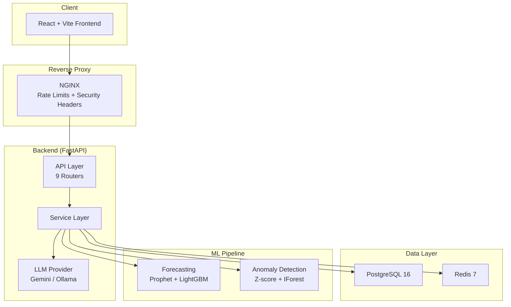
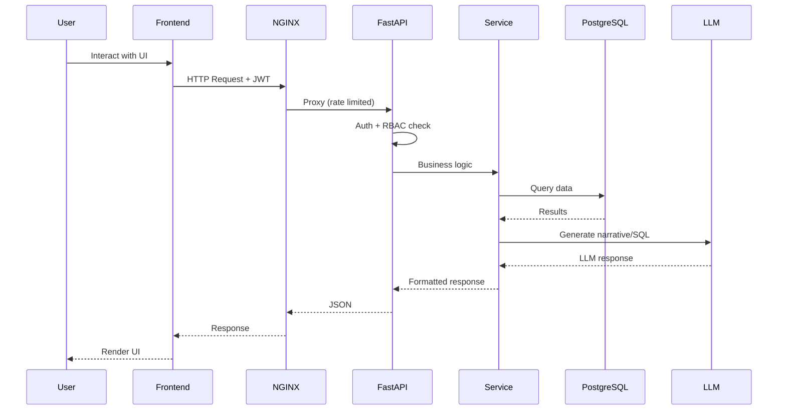
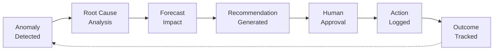
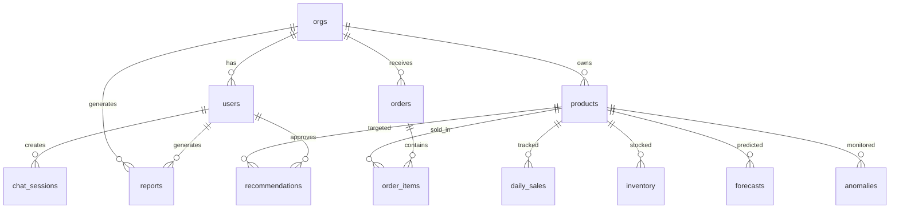

# Architecture Diagram

## System Overview

## Request Flow

## Closed-Loop Pipeline

## Data Model (Key Tables)

## Module Map

| Module | Router | Service | Models |
|--------|--------|---------|--------|
| Auth & RBAC | `auth.py` | `auth_service.py` | `user.py`, `org.py` |
| KPI Dashboard | `kpi.py` | `kpi_service.py` | views: `v_kpi_daily` |
| Forecasting | `forecast.py` | `forecasting_service.py` | `analytics.py` |
| Inventory | `inventory.py` | `inventory_service.py` | `inventory.py` |
| Anomaly Detection | `anomaly.py` | `anomaly_service.py` | `alert.py` |
| AI Copilot (NL2SQL) | `copilot.py` | `copilot_service.py` | `chat_session.py` |
| Reports & Approvals | `report.py` | `report_service.py` | `report.py` |
| BYOD Upload | `admin.py` | `upload_service.py` | — |
| LLM Abstraction | — | `llm/` | — |
