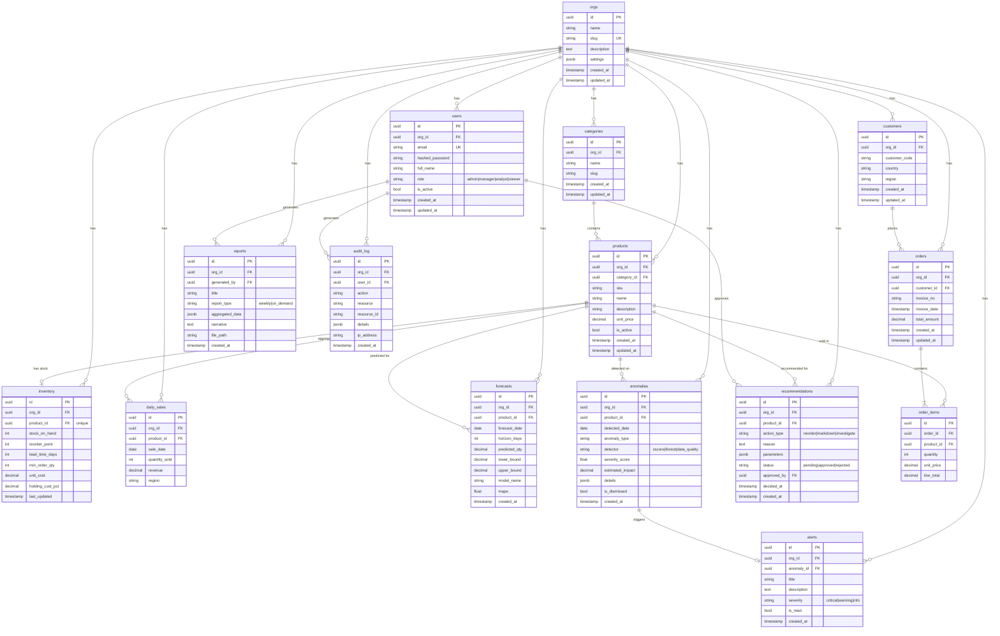

# Database Schema — ER Diagram

> Auto-generated from the Phase 1 database design. Updated: 2026-10-15.

## Entity-Relationship Diagram

## SQL Views

| View | Purpose | Source Tables |
|------|---------|-------------- |
| `v_kpi_daily` | Daily KPIs: revenue, order count, AOV, unique customers | `orders` |
| `v_sales_by_product` | Product-level totals with category name | `daily_sales`, `products`, `categories` |
| `v_sales_by_region` | Regional breakdown by date | `daily_sales` |
| `v_inventory_status` | Current stock with classification label | `inventory`, `products`, `categories` |

## Access Control

- **`bi_readonly`** role has `SELECT` on views only — used by NL2SQL executor.
- Application queries use the main connection with full access.
- Generated SQL is validated and executed only on the read-only connection.

## Data Notes

> ⚠️ **Inventory, lead-time, and cost data are SYNTHETIC** unless stated otherwise.
> Transactional data comes from the UCI Online Retail II dataset (or synthetic fallback).
